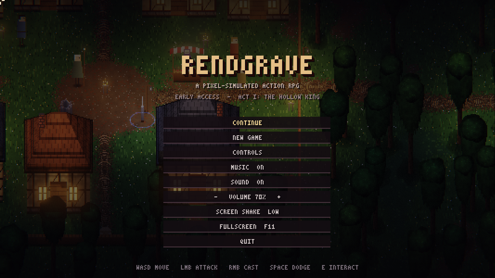
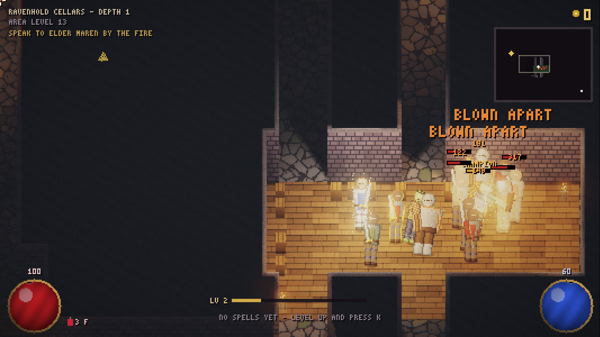
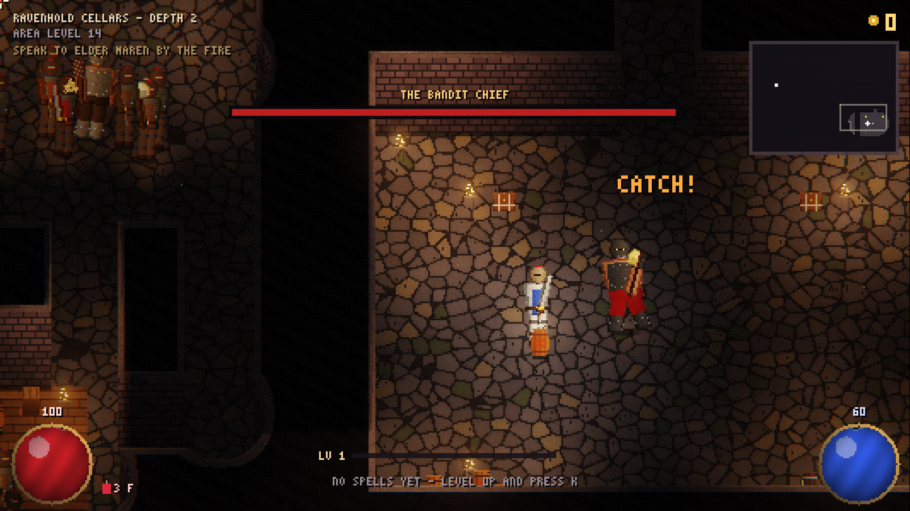
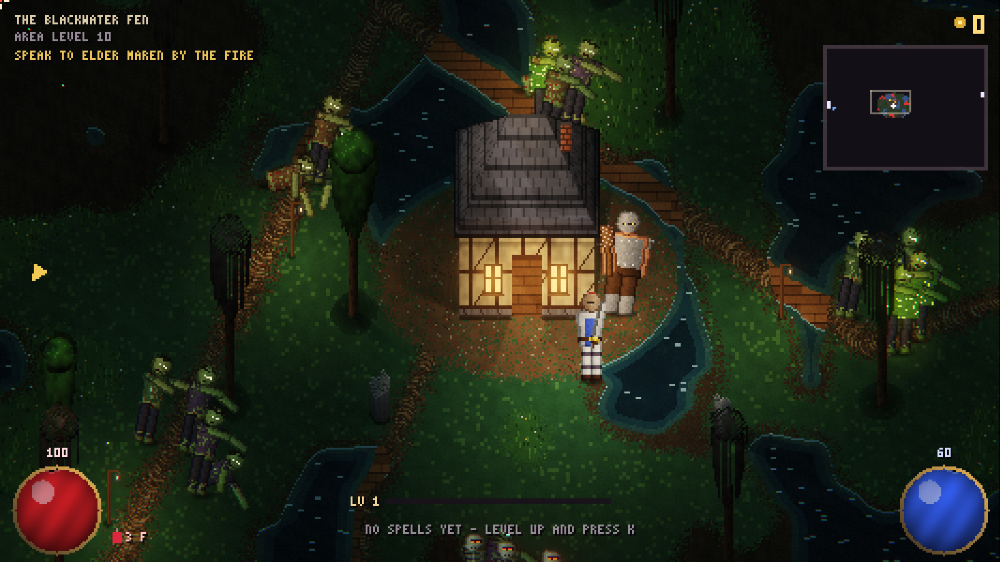
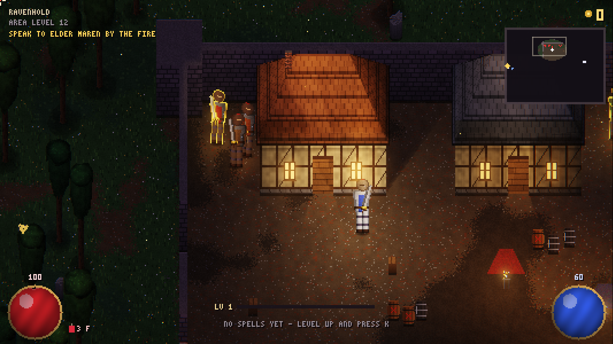
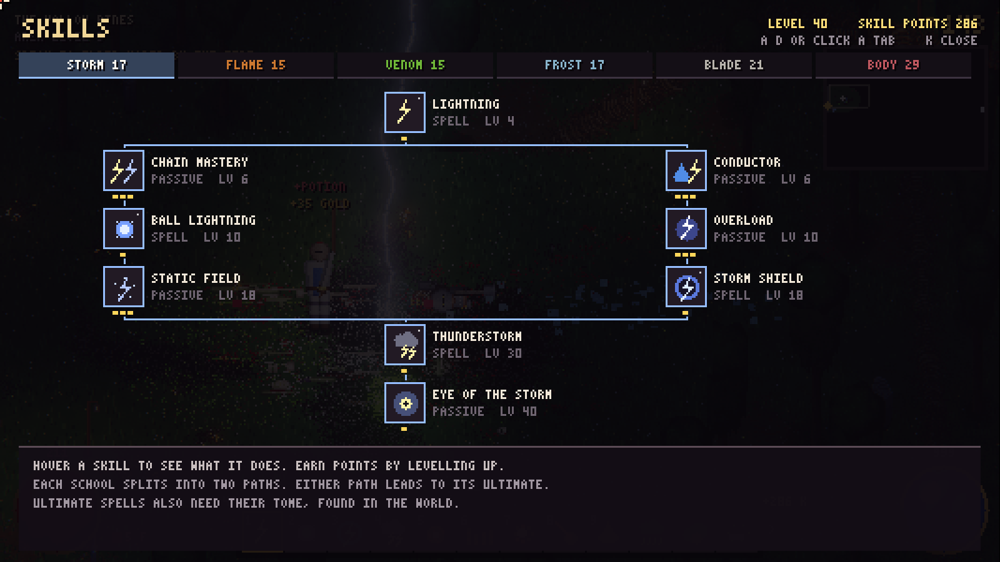

<div align="center">

```
 ____                    _
|  _ \   ___  _ __    __| |  __ _  _ __   __ _ __   __  ___
| |_) | / _ \| '_ \  / _` | / _` || '__| / _` |\ \ / / / _ \
|  _ < |  __/| | | || (_| || (_| || |   | (_| | \ V / |  __/
|_| \_\ \___||_| |_| \__,_| \__, ||_|    \__,_|  \_/   \___|
                            |___/
                a pixel-simulated action RPG
```

**Every blade, flame and blast tears the world - and the dead - apart.**




</div>

---

## What is it?

Rendgrave is a dark-fantasy hack-and-slash where **every enemy is made of pixels, and every pixel counts**.
The dead are built in layers, so your sword doesn't just take off hit points, it takes off *arms*:

```
        .-.            ARMOUR  ███   dented, cracked, knocked loose
       (o o)           CLOTH   ▓▓▓   burns, chars, tears
       | = |           FLESH   ▒▒▒   cut, melted by acid, frozen solid
      /|   |\          BONE    ░░░   what's left when the rest is gone
     / |___| \
       /   \           aim low  ->  the legs come off and it crawls after you
      /     \          freeze it -> one more blow and it shatters
```

The world is simulated too. Oil spreads and catches fire, fire spreads through grass and peat,
swamp gas pools in the hollows waiting for a spark, lightning runs through water and blood,
and powder kegs chain-explode.

<div align="center">

| | |
|:-:|:-:|
|  |  |
| *A powder keg goes up among the bandits* | *The Bandit Chief's hall* |
|  |  |
| *The Blackwater Fen* | *Ravenhold, the bandit castle* |

</div>

## Act I: The Hollow King

```
                         ┌──────────────────┐
                         │   ASHFORD  (1)   │  town · waypoint · merchant · Elder Maren
                         └────────┬─────────┘
                                  │
                         ┌────────┴─────────┐
                         │ HOLLOW PINES (3) │  river bridge · logging camp
                         └───┬──────────┬───┘
                             │          │
            ┌────────────────┴──┐    ┌──┴────────────────────┐
            │ OLD GRAVEYARD (8) │    │ BLACKWATER FEN (10)   │  peat · swamp gas · bloaters
            └────────┬──────────┘    └──────────┬────────────┘
                     │                          │
            ┌────────┴──────────┐    ┌──────────┴────────────┐
            │ SUNKEN CRYPT 1-3  │    │ RAVENHOLD (12)        │  walled bandit castle
            │      (5-7)        │    └──────────┬────────────┘
            │  ☠ HOLLOW KING    │               │
            └───────────────────┘    ┌──────────┴────────────┐
                                     │ RAVENHOLD CELLARS 1-2 │
                                     │       (13-14)         │
                                     │  ☠ BANDIT CHIEF       │
                                     └───────────────────────┘
```

- **Cut, burn, melt, freeze, shatter.** Five weapon types that fight differently: swords slice, axes chop, hammers crush, spears pierce, daggers bleed.
- **Six schools:** Storm, Flame, Venom, Frost, Blade and Body, with 54 skills in all. Act I takes a build to about level 18.
- **Bosses with bodies that matter.** Break the Hollow King's knee plates to stop his slam, cut off his sword arm, smash his breastplate to bare a glowing core. The Bandit Chief throws lit powder kegs.
- **Loot:** magic and rare affixes, legendaries with unique powers, and champions that burn, freeze, drain, rush or explode.
- **Secrets:** cracked walls hiding treasure, grave robbers, urns and crates, kill streaks, quiet places off the path.
- **An original chiptune soundtrack** and fully synthesised sound effects.



## Controls

Keyboard and mouse, or an Xbox-style gamepad. The game switches the moment you touch either one,
and every on-screen hint swaps to match.

| Action | Keyboard & mouse | Gamepad |
|---|---|---|
| Move | `W` `A` `S` `D` | Left stick |
| Attack | Left mouse | `A` |
| Cast | Right mouse (`1`-`9` pick a spell) | `X` `Y` `B` (set them in the skill tree) |
| Aim | Mouse | Right stick, or let go to auto-aim |
| Dodge roll | `Space` | `RB` |
| Potion | `F` | `LB` |
| Oil flask | - | `RT` |
| Interact | `E` | `A` |
| Skill tree | `K` / `Tab` | D-pad up |
| Gear | `I` | D-pad down / `Back` |
| Pause | `Esc` | `Start` |
| Fullscreen | `F11` | - |

## Building

You need a recent stable [Rust](https://rustup.rs) toolchain.

```bash
cargo run --release              # title screen: continue or start a new game
cargo run --release -- --new     # straight into a fresh character
cargo test --release             # regression tests
python tools/package.py          # itch.io build: dist/Rendgrave-EA-<version>-windows.zip + dist/press/
```

Saves live next to the executable (`rendgrave_save.txt`, with a `.bak` of the one before).

<details>
<summary><b>Screenshot and test modes</b></summary>

```bash
cargo run --release -- --showcase shots   # scripted fight, screenshots to shots/
cargo run --release -- --lab lab          # enemy lineup, one effect each
cargo run --release -- --spells spl       # every spell cast, plus the skill tree
cargo run --release -- --tour tour        # visits and screenshots every area
cargo run --release -- --loot loot        # weapons, loot and the gear screen
cargo run --release -- --maps maps        # overview picture of every area's layout
cargo run --release -- --menus menus      # title, pause menu, end-of-act card
cargo run --release -- --extras extras    # secrets, champions, robbers, streaks, gamepad prompts
cargo run --release -- --sfx-dump sfx     # every synthesised sound effect to WAV
cargo run --release -- --navtest          # do hidden enemies find their way to you?
cargo run --release -- --bosstest         # a bot fights both bosses with five builds
# add --press to any picture mode to hide hints and banners for store shots
```

</details>

<details>
<summary><b>How it works</b></summary>

```
  CPU                                              GPU (wgpu)
  ───────────────────────────────────────────      ──────────────────────────────
  world.rs   material grid: liquids, fire,   ─┐
             acid, peat, gas                  │
  body.rs    layered pixel bodies             ├─>  render.rs paints low-res   ─>  gfx.rs + shader.wgsl
  game.rs    player, enemies, spells,         │    albedo / emission / light       lighting, shadows,
             projectiles, gibs                │    buffers with depth sorting      bloom, tonemap,
  hud.rs     orbs, spell bar, menus          ─┘                                    upscale
```

| File | What it does |
|---|---|
| `world.rs` | The simulated material grid: liquids, fire, acid, peat and swamp gas |
| `body.rs` | Layered pixel bodies: cutting, burning, acid, splitting into pieces |
| `anatomy.rs` · `kingparts.rs` | Bodies that change the fight; the Hollow King coming apart |
| `game.rs` | Player, enemies and AI, the sword, projectiles, gibs, particles |
| `gear.rs` · `items.rs` · `uniques.rs` | Weapon types, affixes, legendaries, loot |
| `skills.rs` · `talents.rs` · `spells.rs` | The six skill trees and every spell |
| `bosses.rs` · `champions.rs` | Boss moves; champion powers |
| `areagen.rs` · `areas.rs` | Area generators; exits, waypoints, saving |
| `barrels.rs` · `props.rs` | Kegs, oil and acid barrels; chests and shrines |
| `story.rs` · `agency.rs` · `quiet.rs` | Elder Maren and Act I; starting gifts; a town that remembers |
| `nav.rs` | Enemy pathfinding with a flow field from the player |
| `pad.rs` | Gamepad: auto-aim, virtual menu cursor, button names |
| `render.rs` · `gfx.rs` · `shader.wgsl` | CPU painting and GPU lighting |
| `hud.rs` · `menu.rs` · `shop.rs` | HUD, menus, the merchant |
| `audio.rs` · `synth.rs` | Music crossfades; synthesised sound effects |
| `tests.rs` | Regression tests, including a walk through 750 generated dungeon layouts |

</details>

## Roadmap

```
  [■■■■■■■■■■]  Act I    The Hollow King      <- Early Access, playable now
  [□□□□□□□□□□]  Act II   The Frozen North     frozen lakes that crack underfoot, ice caves
  [□□□□□□□□□□]  Act III  The Burning Lands
  [□□□□□□□□□□]  Act IV   The source of the dead
```

See [ROADMAP.md](ROADMAP.md) for the details and [DESIGN.md](DESIGN.md) for the design notes.

---

<div align="center">

```
   ⚔  made in Rust, one pixel at a time  ⚔
```

</div>
